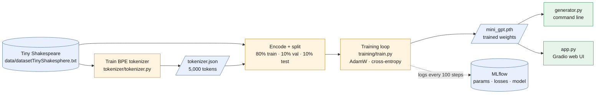
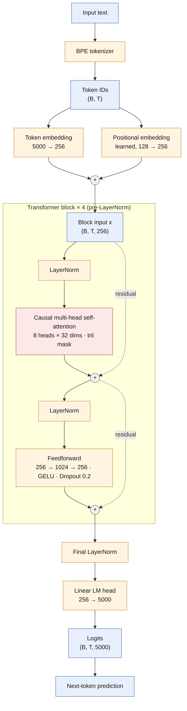
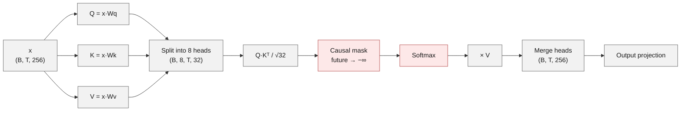
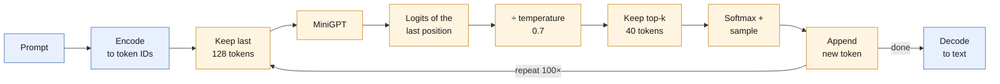

# Mini-GPT from Scratch

A small GPT-style Transformer language model built from scratch in PyTorch and trained on Tiny Shakespeare.

The goal is to understand how modern LLMs work internally by writing every core piece by hand: causal multi-head self-attention, feedforward layers, residual connections, layer normalization, the training loop and autoregressive sampling. The only library pieces used are PyTorch building blocks (`nn.Linear`, `nn.Embedding`, `nn.LayerNorm`) and the Hugging Face `tokenizers` library for BPE.

The project also includes MLflow experiment tracking, a Gradio web demo and a GitHub Actions CI check.

---

## Features

- **Decoder-only Transformer** written from scratch (no `nn.MultiheadAttention` or `nn.TransformerDecoder`)
- **Byte Pair Encoding (BPE) tokenizer** with a 5,000-token vocabulary, trained on the dataset
- **Train / validation / test split** (80 / 10 / 10) with periodic loss evaluation
- **MLflow tracking** of hyperparameters, losses and the trained model
- **Top-k + temperature sampling** for text generation
- **Gradio web UI** for trying prompts in the browser
- **CI pipeline** that installs dependencies and checks that the model imports

---

## Project Pipeline

How data, code and outputs connect from raw text to generated text:



---

## Architecture

The model is a decoder-only Transformer. Shapes are shown for batch size `B` and sequence length `T ≤ 128`:



Each block applies LayerNorm **before** each sub-layer and adds the result back to its input, as in GPT-2:

```
x = x + MultiHeadAttention(LayerNorm(x))
x = x + FeedForward(LayerNorm(x))
```

Inside the attention layer, the causal mask stops each token from seeing tokens that come after it:



| Component | File | Details |
|---|---|---|
| Multi-head self-attention | [model/attention.py](model/attention.py) | Separate Q/K/V projections, scaled dot-product attention, causal mask (`torch.tril`) so each token only attends to earlier tokens, output projection |
| Feedforward network | [model/feedforward.py](model/feedforward.py) | `Linear(d → 4d) → GELU → Linear(4d → d) → Dropout(0.2)` |
| Transformer block | [model/transformer_block.py](model/transformer_block.py) | Pre-LN attention + feedforward, each with a residual connection |
| GPT model | [model/gpt_model.py](model/gpt_model.py) | Learned token and positional embeddings, stacked blocks, final LayerNorm, linear LM head |

With the default config the model has about **5.8M parameters**.

---

## Project Structure

```
Mini-GPT/
├── model/
│   ├── attention.py          # Causal multi-head self-attention
│   ├── feedforward.py        # Position-wise feedforward network
│   ├── transformer_block.py  # Pre-LN Transformer block
│   ├── gpt_model.py          # MiniGPT model
│   └── config.py             # Hyperparameters
│
├── tokenizer/
│   ├── tokenizer.py          # Trains the BPE tokenizer
│   └── tokenizer.json        # Trained tokenizer (5,000 tokens)
│
├── training/
│   ├── dataset.py            # Random batch sampling (get_batch)
│   └── train.py              # Training loop, evaluation, MLflow logging
│
├── data/
│   └── datasetTinyShakesphere.txt   # Tiny Shakespeare (~1.1M characters)
│
├── mlruns/                   # MLflow run history
├── .github/workflows/ci.yml  # GitHub Actions CI
├── app.py                    # Gradio web demo
├── generator.py              # Command-line text generation
├── requirements.txt
└── README.md
```

---

## Configuration

All hyperparameters live in [model/config.py](model/config.py):

| Parameter | Value | Meaning |
|---|---|---|
| `vocab_size` | 5000 | BPE vocabulary size |
| `block_size` | 128 | Context length in tokens |
| `embed_dim` | 256 | Embedding / hidden size |
| `heads` | 8 | Attention heads (32 dims each) |
| `layers` | 4 | Transformer blocks |
| `batch_size` | 32 | Sequences per training step |
| `learning_rate` | 3e-4 | AdamW learning rate |
| `max_iters` | 4000 | Training steps |

The scripts pick the device automatically (CUDA if available, otherwise CPU).

---

## Getting Started

### 1. Install dependencies

```bash
pip install -r requirements.txt
pip install mlflow        # needed for training/train.py
```

`requirements.txt` covers `torch`, `tokenizers` and `gradio`. MLflow is only needed for training.

### 2. (Optional) Retrain the tokenizer

A trained tokenizer is already included at `tokenizer/tokenizer.json`. To rebuild it, update the dataset path in [tokenizer/tokenizer.py](tokenizer/tokenizer.py) (it is currently an absolute `D:/` path) and run:

```bash
python tokenizer/tokenizer.py
```

### 3. Train the model

Run from the project root as a module so the `model` and `training` imports resolve:

```bash
python -m training.train
```

This will:

- tokenize the dataset and split it 80 / 10 / 10 into train / validation / test
- train with AdamW and cross-entropy loss for `max_iters` steps
- print and log train / validation loss every 100 steps
- report the final test loss
- save the weights to `mini_gpt.pth` and log the model to MLflow

Training was done on a GPU in Google Colab, which is much faster than CPU.

> The MLflow tracking URI in [training/train.py](training/train.py) is hardcoded to `file:///D:/MINI-GPT/mlruns`. Change it to match your machine.

The trained checkpoint `mini_gpt.pth` (~23 MB) is listed in `.gitignore`, so you need to train the model (or copy in your own checkpoint) before generating text.

### 4. Generate text

**Command line:**

```bash
python generator.py
```

This uses the prompt `"All: "` set in the script and generates 100 new tokens.

**Web UI (Gradio):**

```bash
python app.py
```

Open the local URL Gradio prints (usually http://127.0.0.1:7860), type a prompt and submit.

Both scripts generate text one token at a time:



Sampling settings:

- `temperature = 0.7`: values below 1 make the output more focused
- `top_k = 40`: sample only from the 40 most likely tokens
- `max_new_tokens = 100`
- a sliding context window of the last `block_size` tokens

### 5. View experiments in MLflow

```bash
mlflow ui --backend-store-uri ./mlruns
```

Each run logs its hyperparameters, `train_loss`, `val Loss`, `test loss` and the trained PyTorch model.

---

## Dataset

The model is trained on **Tiny Shakespeare**, about 1.1M characters of Shakespeare's plays. It is small enough to train quickly but still has clear structure (speaker names, verse, dialogue) for the model to learn.

---

## Results

Loss from the most recent logged run (4,000 steps, default config):

| Step | Train loss | Validation loss |
|---|---|---|
| 0 | 8.69 | 8.58 |
| 1000 | 4.71 | 5.39 |
| 2000 | 3.94 | 5.45 |
| 3000 | 3.03 | 5.91 |
| 3900 | 2.27 | 6.57 |

Final test loss: **7.19**

The starting loss of ~8.6 is about what random guessing gives over 5,000 tokens (ln 5000 ≈ 8.5). Training loss keeps falling, but **validation loss bottoms out around step 1,000 and then rises**, so the model **overfits** the small dataset after that point. Early stopping, more dropout, or a smaller model would help (see Possible Improvements).

Example output from the Gradio app (prompt: `summarise the story!`):

```
... I beseech you , sir , That I was mine own hands before You s for the king ,
to plead ed by Hath pass ' d his inj ury ; ... AUTOLYCUS : Fie , fie , fie !
what a fault ? AUTOLYCUS : How hast thou dra in him ? Shepherd : I beseech you , sir , I
```

The model picks up Shakespeare's style: speaker tags such as `AUTOLYCUS :`, archaic words and dialogue rhythm. It is not trained to follow instructions, so it continues the prompt as text instead of answering it.

---

## Key Concepts Implemented

- Byte Pair Encoding (BPE) tokenization
- Token embeddings and learned positional embeddings
- Scaled dot-product attention with a causal mask
- Multi-head self-attention
- Position-wise feedforward network with GELU
- Residual connections and pre-layer normalization
- Cross-entropy loss for next-token prediction
- Train / validation / test evaluation
- Autoregressive generation with temperature and top-k sampling
- Experiment tracking with MLflow

---

## CI

[.github/workflows/ci.yml](.github/workflows/ci.yml) runs on every push to `main` and on pull requests. It sets up Python 3.11, installs `requirements.txt` and checks that `MiniGPT` imports.

---

## Limitations and Known Issues

- **Overfitting:** validation loss rises after about 1,000 steps on this small dataset.
- **Spaces in decoded text:** the tokenizer splits on whitespace but has no matching decoder, so output contains extra spaces between subword pieces (e.g. `inj ury`, `pass ' d`). `app.py` only fixes spaces before `,` and `.`.
- **Small model:** about 5.8M parameters with a 128-token context.
- **Hardcoded paths:** the tokenizer training script and the MLflow tracking URI use absolute `D:/` paths.
- **GPU check on import:** `training/dataset.py` prints CUDA device info when imported and calls `torch.cuda.get_device_name(0)`, which fails on CPU-only machines. Remove those lines to train on CPU.
- **Missing dependency:** `mlflow` is not listed in `requirements.txt`.

---

## Possible Improvements

- Add early stopping and save the checkpoint with the best validation loss
- Add dropout to attention and embeddings to reduce overfitting
- Add a `ByteLevel` or `Metaspace` decoder to the tokenizer so decoded text has correct spacing
- Use weight tying between the token embedding and the LM head
- Add a learning-rate warmup and cosine decay schedule
- Add checkpoint saving and resuming during training
- Train on a larger dataset with a larger vocabulary and model
- Make generation settings (temperature, top-k, length) adjustable in the Gradio UI

---

## Summary

This project builds a GPT-style language model from the ground up: tokenizer, attention, Transformer blocks, training loop and sampling. It is small enough to read in one sitting and train on a single GPU, and it shows in practice how attention, residual connections and next-token prediction combine into a working language model.
